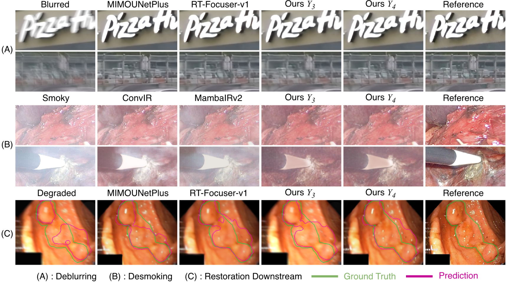
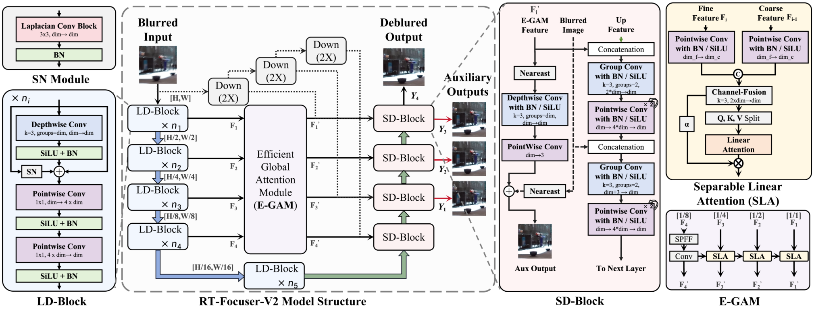
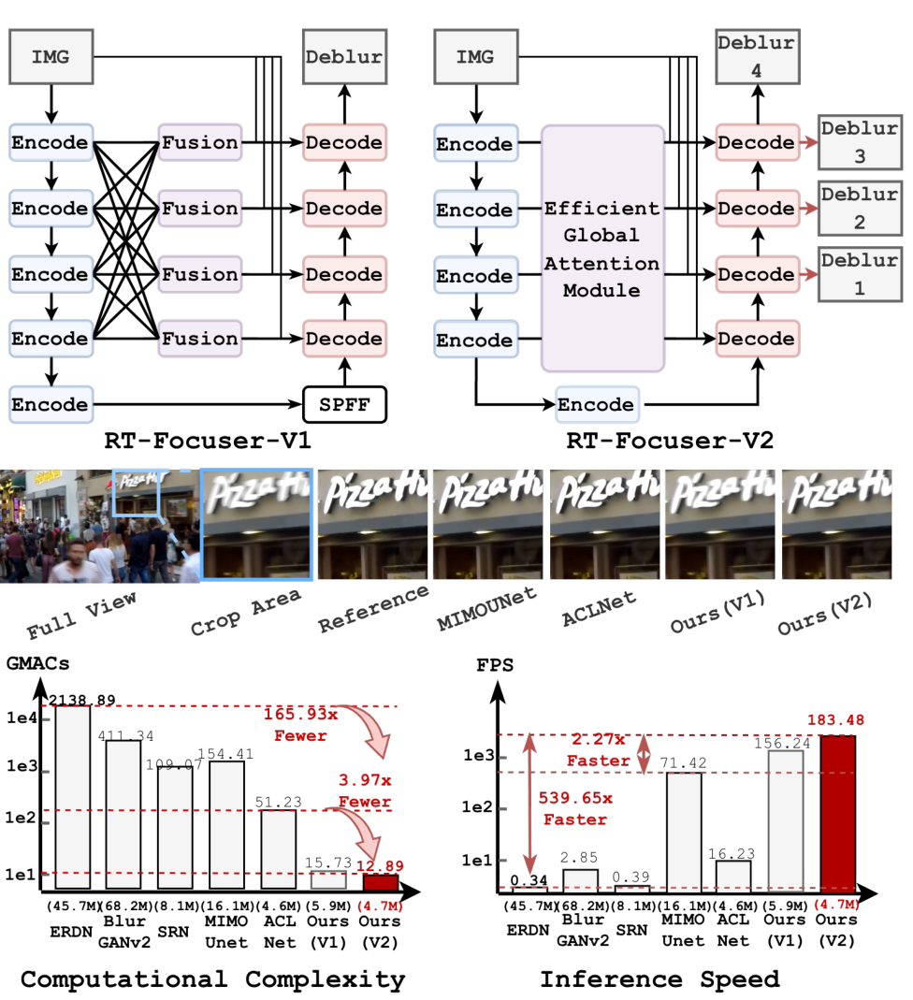

<div align="center">

# RT-Focuser-V2

### Towards Efficient Real-time Restoration

**Progressive All-Scale Attention for Real-Time Image Deblurring**

Restore detail. Choose your compute budget. Support downstream perception.

[](rt_focuser_v2.py)
[](#four-exits-one-network)
[](#beyond-deblurring)
[](LICENSE)

**[Why V2?](#why-rt-focuser-v2)** · **[Architecture](#architecture)** · **[Results](#results)** · **[Beyond deblurring](#beyond-deblurring)** · **[Quick start](#quick-start)**



*One efficiency-driven design, evaluated across image restoration and downstream perception.*

</div>

> [!TIP]
> **New in V2:** Efficient Global Attention (E-GAM), four selectable restoration exits, and progressive self-distillation. Experiments extend from **GoPro deblurring** to **SurgClean desmoking** and **endoscopic segmentation** on Kvasir, ClinicDB, and ColonDB.

## Why RT-Focuser-V2?

Our goal is to push **Efficient Real-time Restoration**: recover useful visual information within the compute and latency budgets of the devices that actually run the model. A practical restoration network must balance image quality, computation, and runtime while preserving details that matter for later vision tasks.

[RT-Focuser-V1](https://github.com/ReaganWu/RT-Focuser) established our lightweight edge deblurring baseline. V2 takes the next step: **replace repeated dense cross-scale fusion with E-GAM, and expose four restoration paths within one network**. The exit is selected before inference, giving each deployment a fixed execution path suited to its processing budget.

We also ask a broader question: **does efficient restoration remain useful beyond deblurring?** We evaluate the design on task-specific surgical desmoking and on restoration before a frozen endoscopic segmenter. These experiments examine both image reconstruction and the structures needed for downstream perception.

| ⚡ Efficient by design | 🎛️ Choose your operating point | 🔬 Validate beyond one task |
| :--- | :--- | :--- |
| Lightweight LD blocks and **E-GAM with Separable Linear Attention (SLA)** aggregate context progressively. | **Fastest, Fast, Balanced, Accurate** expose four quality–latency choices through Y1–Y4. | **Deblurring, desmoking, and downstream segmentation** test restoration quality, speed, and practical utility. |

## Architecture

<p align="center">
  
</p>

**E-GAM** propagates context from coarse to fine scales through SLA. **Progressive restoration exits** allow intermediate predictions as well as a full decoder output. During training, all exits receive reconstruction supervision, and the final output guides earlier exits through **progressive self-distillation**.

<details>
<summary><strong>From V1 to V2: architecture, visual detail, and efficiency overview</strong></summary>

<p align="center">
  
</p>

The overview combines the architecture evolution with the reported 256 × 256 complexity and throughput comparison. Backend-specific measurements are listed below.

</details>

## Results

### Four exits, one network

Reported GoPro results. Parameters and GMACs refer to the selected deployment path.

| Mode | Exit | PSNR | SSIM | Params | GMACs |
| --- | ---: | ---: | ---: | ---: | ---: |
| Accurate | Y4 | 31.03 | 0.9172 | 4.72M | 12.89 |
| Balanced | Y3 | 30.26 | 0.9007 | 1.80M | 4.49 |
| Fast | Y2 | 28.37 | 0.8743 | 1.27M | 4.07 |
| Fastest | Y1 | 25.67 | 0.8012 | 1.25M | 3.63 |

**Y3 is the balanced operating point:** compared with Y4, it uses **65.2% fewer MACs** for a **0.77 dB** PSNR difference on GoPro. Y4 provides the strongest reconstruction quality, while Y1 and Y2 prioritize lower latency.

### Cross-platform throughput

FPS at **256 × 256**, batch size **1**:

| Mode | iPhone 15 | Apple M4 | Intel i7-13700H | RTX 3090 |
| --- | ---: | ---: | ---: | ---: |
| Fastest (Y1) | 259.06 FPS | 434.78 FPS | 54.45 FPS | 309.27 FPS |
| Fast (Y2) | 223.95 FPS | 384.61 FPS | 45.67 FPS | 278.95 FPS |
| Balanced (Y3) | 194.55 FPS | 322.58 FPS | 37.30 FPS | 253.84 FPS |
| Accurate (Y4) | 134.58 FPS | 212.76 FPS | 18.18 FPS | 183.48 FPS |

Core ML is used on iPhone 15 and Apple M4, OpenVINO on Intel i7-13700H, and ONNX Runtime CUDA on RTX 3090. Measurements use a fixed-exit deployment graph and describe model inference throughput.

## Beyond deblurring

The extended experiments test **transfer of the architecture to another restoration task** and **restoration as a preprocessing stage for perception**. Desmoking uses task-specific training; segmentation uses a shared frozen SegFormer-B0 after restoration.

### Surgical desmoking · SurgClean

We train RT-Focuser-V2 specifically for desmoking and evaluate at **720P (1280 × 720)** on RTX 3090.

| Mode | PSNR ↑ | SSIM ↑ | FPS ↑ |
| :--- | ---: | ---: | ---: |
| Accurate · Y4 | **19.523** | **0.666** | 13.39 |
| Balanced · Y3 | 19.463 | 0.664 | 21.98 |
| Fast · Y2 | 19.349 | 0.645 | 25.57 |
| Fastest · Y1 | 19.057 | 0.598 | **27.25** |

Y3 retains nearly the Y4 PSNR while increasing throughput from 13.39 to 21.98 FPS. These 720P measurements use a different resolution from the 256 × 256 deblurring results above.

### Restoration for endoscopic segmentation

Does removing degradation help a downstream model recover polyp boundaries? We compare identical degraded inputs using a **shared frozen SegFormer-B0** on **200 held-out Kvasir images**, **612 ClinicDB images**, and **380 ColonDB images**. Restoration models are trained for the endoscopic degradation setting.

| Input / restoration | Kvasir Dice ↑ | ClinicDB Dice ↑ | ColonDB Dice ↑ | Mean Dice ↑ |
| :--- | ---: | ---: | ---: | ---: |
| Clean reference | 0.8530 | 0.5755 | 0.5009 | 0.6431 |
| Blurred input | 0.6775 | 0.4173 | 0.3171 | 0.4707 |
| MIMO-UNetPlus | 0.8225 | 0.5642 | **0.4584** | 0.6150 |
| RT-Focuser-V1 | 0.8189 | 0.5516 | 0.4491 | 0.6065 |
| **RT-Focuser-V2 · Y4** | **0.8251** | **0.5722** | 0.4557 | **0.6177** |

*Bold values compare restoration methods; the clean-input row is a reference. Mean Dice is the unweighted mean across the three datasets.*

Y4 improves mean Dice from **0.4707 to 0.6177**. This experiment motivates evaluating restoration by both pixel-level fidelity and its contribution to downstream perception. Exit selection remains task-dependent: Y4 gives the strongest segmentation result in these experiments.

<details>
<summary><strong>View downstream results for the earlier exits</strong></summary>

| Mode | Kvasir Dice ↑ | ClinicDB Dice ↑ | ColonDB Dice ↑ | Mean Dice ↑ |
| :--- | ---: | ---: | ---: | ---: |
| Balanced · Y3 | 0.6834 | 0.4306 | 0.3339 | 0.4826 |
| Fast · Y2 | 0.6877 | 0.4314 | 0.3279 | 0.4824 |
| Fastest · Y1 | 0.6678 | 0.4028 | 0.3218 | 0.4641 |

</details>

The opening visual comparison shows **(A)** GoPro deblurring, **(B)** SurgClean desmoking, and **(C)** downstream polyp segmentation. Green contours indicate ground truth; magenta contours indicate predictions.

## Quick start

### Installation

```bash
git clone https://github.com/ReaganWu/RT-Focuser-v2.git
cd RT-Focuser-v2
python -m venv .venv
source .venv/bin/activate
pip install -r requirements.txt
```

### Inference

The current code release includes the model, inference, GoPro training and evaluation, and export utilities. Pretrained checkpoints and task-specific desmoking / segmentation pipelines are not included in this repository yet.

With a compatible checkpoint at `weights/rt-focuser-v2-gopro.pth`, run:

```bash
python inference.py \
  --checkpoint weights/rt-focuser-v2-gopro.pth \
  --input /path/to/blur.png \
  --output results/restored.png \
  --exit 4
```

Use `--exit 1`, `2`, `3`, or `4` for the Fastest, Fast, Balanced, or Accurate operating mode.

## Evaluation

Arrange the GoPro dataset as follows:

```text
GOPRO_Large/
  train/<sequence>/blur_gamma/*.png
  train/<sequence>/sharp/*.png
  test/<sequence>/blur_gamma/*.png
  test/<sequence>/sharp/*.png
```

Evaluate a fixed exit:

```bash
python evaluate.py \
  --data-root /path/to/GOPRO_Large \
  --checkpoint weights/rt-focuser-v2-gopro.pth \
  --exit 4
```

## Training

```bash
python train.py \
  --data-root /path/to/GOPRO_Large \
  --output-dir runs/rt-focuser-v2 \
  --device cuda
```

The training objective applies equal supervision to all exits using L1 and FFT-L1 reconstruction terms, with progressive self-distillation from Y4 to earlier exits.

## Deployment

Export one ONNX graph at a time so unused later decoder stages are removed from the deployment graph:

```bash
python rt_focuser_v2.py \
  --checkpoint weights/rt-focuser-v2-gopro.pth \
  --exit 4 \
  --out-dir exports/Y4 \
  --skip-coreml
```

For Core ML export on macOS, install `coremltools` and omit `--skip-coreml`. See [requirements.txt](requirements.txt) for optional export dependencies.

## Repository guide

| File | Purpose |
| :--- | :--- |
| [rt_focuser_v2.py](rt_focuser_v2.py) | RT-Focuser-V2, E-GAM, SLA, fixed-exit export and benchmarking |
| [inference.py](inference.py) | Single-image restoration with a selected exit |
| [train.py](train.py) · [losses.py](losses.py) | GoPro training and progressive multi-exit supervision |
| [evaluate.py](evaluate.py) · [data.py](data.py) | GoPro evaluation and paired-image loading |
| [assets/](assets/) | Architecture, overview, and qualitative comparisons |

Looking for the original model? Visit **[RT-Focuser-V1](https://github.com/ReaganWu/RT-Focuser)**.

## License

This project is released under the MIT License. The GoPro dataset is distributed separately under its own terms.
